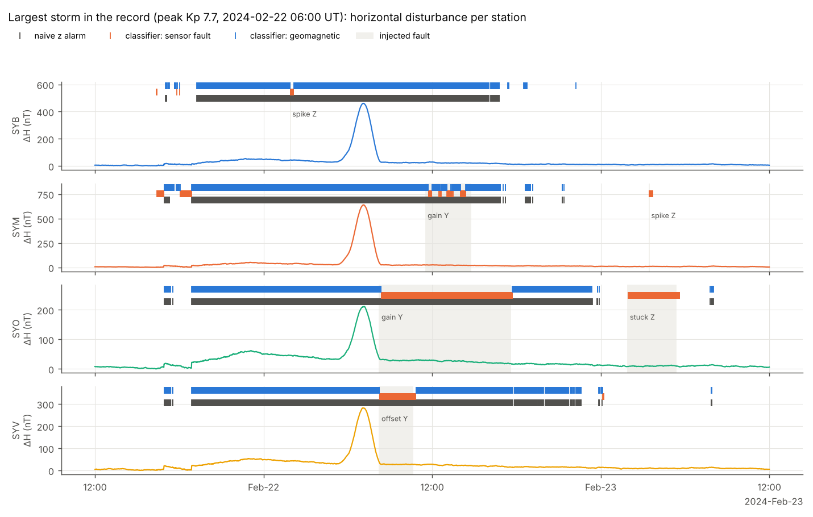
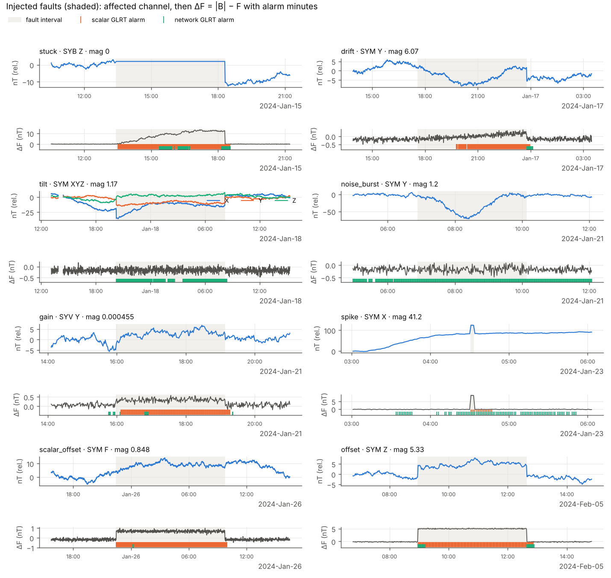

# magfault

**Is the sensor broken, or did the field actually change?**
A PostgreSQL + detection-theory pipeline that separates instrument faults from real
geomagnetic disturbances across a network of observatory magnetometers.

Every magnetometer array has to answer this question. That includes observatory
networks and wearable arrays used for magnet localization. A reading deviates from
what you expect, and the cause is either the instrument or a real change in the
field. A single-sensor anomaly detector cannot tell the two apart. During a
geomagnetic storm it either floods operators with false alarms or gets tuned so
loose that it misses real faults.

This project solves the problem with two pieces of physics and a network:

1. **Vector–scalar consistency.** INTERMAGNET observatories measure the field
   vector (X, Y, Z) and, independently, its total intensity F with a scalar
   magnetometer. The residual ΔF = |B| − F does not respond to the external field
   at all. Any persistent change in ΔF therefore points to an instrument.
2. **Observability.** To first order, a vector error δ moves ΔF by b̂·δ, where b̂
   is the unit field direction. At mid-latitudes b̂ ≈ (0.3, 0.05, 0.95). A fault
   on Y is close to invisible to ΔF, and a sensor tilt (a rotation) is exactly
   invisible.
3. **The network.** Each station's disturbance is predicted from the other
   stations. A local residual means a local cause, while a disturbance the whole
   network shares is geophysical.

## Results (synthetic network, reproducible with `make demo`)

The table comes from 4 stations over 90 days with 96 injected faults across 8
fault types, 5 storms, and peak Kp 7.7. The first 14 days are a fault-free
calibration window, and everything after that is scored.

| Method | Event recall | Median delay (min) | False alarms / station-day (quiet) | False alarms / station-day (storm) | Storm minutes flagged as fault | Pointwise F1 | Point-adjusted F1 |
|---|---|---|---|---|---|---|---|
| naive single-station z-score | 0.39 | 0 | 0.419 | 5.33 | 79.4% | 0.30 | 0.49 |
| Isolation Forest | 0.95 | 0 | 2.864 | 5.33 | 94.2% | 0.25 | 0.64 |
| scalar CUSUM (ΔF) | 0.84 | 3 | 0.020 | 0.33 | 2.6% | 0.73 | 0.86 |
| scalar GLRT (ΔF) | 0.81 | 1 | 0.003 | 0.00 | 0.7% | 0.68 | 0.79 |
| network GLRT | 0.72 | 0 | 1.279 | 11.67 | 18.5% | 0.41 | 0.75 |
| **classifier (ΔF + network + coherence)** | **0.96** | **0** | **0.100** | **2.00** | **3.7%** | **0.85** | 0.98 |

What the numbers say:

- **Isolation Forest finds almost every fault, but only by flagging 94% of storm
  minutes.** High recall alone means nothing for this problem. The naive z-score
  has the same failure.
- **The ΔF tests are nearly immune to storms** (0.7% of storm minutes), as the
  physics predicts. They miss tilts (recall 0.17), also as the physics predicts.
- **The network test catches tilts and Y-channel faults** that ΔF cannot see.
  However, it raises false alarms during storms, because substorm signatures are
  not coherent across 50° of longitude. See `sql/queries/04_station_pair_correlation.sql`.
- **The classifier combines the two complementary tests**: 0.96 event recall at
  0.1 false alarms per station-day, with 3.7% of storm minutes mislabeled as faults.
- **Point adjustment inflates every method.** The classifier goes from 0.85 to
  0.98 pointwise F1, and Isolation Forest from 0.25 to 0.64. Point-adjusted F1 is
  shown only for comparison with the literature.

Event recall by fault type:

| Method | drift | gain | noise burst | offset | scalar offset | spike | stuck | tilt |
|---|---|---|---|---|---|---|---|---|
| scalar GLRT | 1.00 | 0.92 | 0.83 | 0.92 | 1.00 | 0.92 | 0.75 | **0.17** |
| network GLRT | 0.83 | 0.67 | 1.00 | 0.67 | **0.17** | 1.00 | 0.42 | 1.00 |
| classifier | 1.00 | 0.92 | 1.00 | 1.00 | 1.00 | 1.00 | 0.83 | 0.92 |

The two tests fail on complementary fault types. Scalar offsets are invisible to
the network, because the vector is untouched. Tilts are invisible to ΔF.

> These are synthetic results that validate the pipeline. Run it on INTERMAGNET
> data (below) for the numbers that matter; expect the network test to be harder
> on real data, where inter-station coherence is lower.



*The largest synthetic storm. The naive detector (grey) alarms through the whole
storm at every station. The classifier labels it geomagnetic (blue) and still
flags the three faults injected during the storm (orange, shaded).*



*One example per fault type. The tilt panel shows the key point: three components
move and ΔF does not, so only the network test catches it.*

Each run writes these figures, `metrics.json`, `summary.md` and `per_fault.csv`
to `reports/run_<id>/`.

## Architecture

```mermaid
flowchart LR
    A[INTERMAGNET GIN<br/>IAGA-2002, 1-min] --> L[load.py<br/>sha256 idempotent<br/>COPY → staging → upsert]
    K[GFZ Kp JSON] --> L
    L --> R[(readings<br/>monthly partitions)]
    R --> I[inject: fault_runs,<br/>injected_faults,<br/>fault_samples]
      R --> O["readings_observed(run)<br/>SQL overlay"]
    I --> O
    O --> F[build_features&#40;run&#41;<br/>PL/pgSQL]
    F --> D[detectors<br/>GLRT · CUSUM · network · IF]
    D --> T[(detections)]
    T --> E[evaluate<br/>event-level, pointwise,<br/>confusion]
```



The clean readings are never modified. A fault run stores only override values,
and `readings_observed(run_id)` overlays them at query time. Many fault scenarios
can therefore coexist against one copy of the data.

## Quick start

```bash
python -m venv .venv && source .venv/bin/activate
pip install -e ".[dev]"
make up initdb          # Postgres 16 in Docker, schema + functions

# Offline: synthetic 4-station network, no downloads (~1 min)
make demo

# Real data: 4 Canadian observatories, 2024 (includes the May 2024 storm)
make download kp load   # STATIONS=VIC,MEA,BRD,OTT START=2024-01-01 END=2024-12-31
make pipeline           # inject -> features -> detect -> evaluate
```

Each step is also a CLI command: `magfault download | kp | synth | load | inject |
features | detect | evaluate`. Run `magfault <cmd> -h` for the options. Use
`make test` for the unit tests. Set `MAGFAULT_TEST_DSN` to a scratch database to
also run the end-to-end database test.

A full year at 4 stations is about 2.1 M rows per run. Feature building is set
based, in a single `CALL build_features(run_id)`.

## The SQL layer

| Object | What it does |
|---|---|
| `readings` | 1-minute X, Y, Z, F; range-partitioned by month, partitions created on demand by `ensure_month_partition()` |
| `ingest_files` | provenance + sha256; reloading the same file is a no-op, a re-published file upserts only changed values |
| `readings_observed(run)` | clean data with a fault run's overrides applied |
| `build_features(run)` | quiet-day selection (5 lowest-Kp days per month), per-minute-of-day median baseline smoothed with a 31-min window, ΔF, disturbance, \|dB/dt\|, robust z-scores (median/MAD), leave-one-out network means, rolling `corr()` against the network |

Standalone analysis queries are in `sql/queries/` and run with `psql -v run=1 -f …`:

- `01_coverage_and_gaps.sql`: coverage per station and month, longest gap (gaps-and-islands)
- `02_flatlines.sql`: stuck-sensor candidates as runs of identical values
- `03_storm_days.sql`: most disturbed days, per-station peak disturbance and dB/dt
- `04_station_pair_correlation.sql`: network coherence, quiet vs storm, by longitude separation
- `05_fault_detection_delay.sql`: first alarm per method for each injected fault (`LATERAL`)
- `06_alarms_vs_kp.sql`: alarm rate vs Kp; a good fault detector is flat in Kp

## Detection

All statistical thresholds come from a false-alarm probability, not from tuning
on the test data.

**Scalar GLRT.** ΔF is prewhitened with an AR(1) model fitted on the calibration
window, giving e_t. Over a 15-minute window two tests are applied:

- unknown mean shift: T = (Σe)²/N ~ χ²(1)
- variance change: T = N(s² − 1 − ln s²) ~ χ²(1) asymptotically

Each test is run at pfa/2 (Bonferroni).

**Scalar CUSUM.** A two-sided CUSUM runs on the same e_t with reference k = 0.5σ.
The threshold h is solved from the Siegmund approximation for an in-control ARL
of 10⁶ minutes. The statistic is capped at 3h so it recovers soon after a fault ends.

**Network GLRT.** Each station's (dx, dy, dz) is regressed on the other stations
(ridge least squares, calibration window). The residual is whitened with the
Cholesky factor of its covariance, then with AR(1) per component, and tested with
the same windowed GLRTs at χ²(3). When several stations alarm in the same minute,
the alarm goes to the largest statistic (leave-one-out isolation). Without that
step, a fault at one station leaks into its neighbours' predictions.

**Guarded thresholds (default).** The analytic threshold assumes Gaussian
residuals. Real residuals have heavier tails, and on the synthetic network the
network test alarms in 1.8×10⁻³ of calibration minutes against a design pfa of
10⁻⁶. Guarded mode uses max(analytic, empirical 1 − 5×10⁻⁴ calibration quantile)
per station. `--thresholds analytic` turns this off.

**Classifier.** Each minute is labeled in order of precedence:

1. A ΔF alarm means a sensor fault, because ΔF is blind to the external field.
2. A network-residual alarm while the rest of the network is quiet means a sensor
   fault.
3. A disturbance the network shares means a geomagnetic event.

## Evaluation

- **Event level.** A fault counts as detected if any alarm falls in
  [t_start, t_end + 20 min]. Delay is measured from t_start. Alarm minutes are
  merged into events, and an event touching no fault is one false alarm. False
  alarms are reported per station-day, split into quiet and storm (Kp ≥ 5).
- **Pointwise** precision/recall/F1. The 20-minute tail after each fault is
  "don't care".
- **Point-adjusted F1** is reported for comparison only, because it inflates scores.
- **3-class confusion matrix** for the classifier. The geomagnetic truth label is
  planetary Kp ≥ 5, which is coarse (3-hourly, global). Most "normal → geomagnetic"
  minutes are real but sub-storm activity at Kp 2–4, so the sensor-fault column is
  the one to read.

## Fault models (`faults.py`)

| Type | Model | Visible to ΔF? |
|---|---|---|
| spike | ±5–50 nT for 1–3 min | yes, scaled by b̂ |
| offset | ±1–10 nT step, 1–12 h | scaled by b̂·e (weak on Y) |
| drift | ramp to ±2–20 nT, 3–24 h | scaled by b̂·e |
| stuck | channel holds its onset value | yes, as the field moves |
| gain | ×(1 ± 10⁻⁴…10⁻³) | yes, scaled by b̂ |
| noise burst | +0.5–3 nT white noise | yes, scaled by b̂ |
| tilt | 0.5–5 arcmin rotation of the vector sensor | **no, \|B\| is preserved** |
| scalar offset | ±0.5–5 nT on F only | yes; **invisible to the network** |

Faults are non-overlapping per station, placed after the calibration window, and
required to have at least 90% data coverage. Every run is reproducible from its seed.

## Limitations and next steps

- The synthetic network is a test bed, not evidence. The real-data run is the result.
- Kp is planetary and 3-hourly. Station-level storm labels could come from SuperMAG
  SME or local K indices.
- The network model is static linear regression. A local-time-aware or lagged
  model (e.g. spherical elementary current systems) would cut storm-time false
  alarms in the network test.
- The thresholds are per minute; a sequential test with an explicit ARL budget per
  station-year would be the operational choice.
- A Grafana panel on `features` and `detections` would make a natural operator view.

## Data and credits

The results presented here rely on data collected at magnetic observatories. We
thank the national institutes that support them and INTERMAGNET for promoting high
standards of magnetic observatory practice (www.intermagnet.org). See the
INTERMAGNET conditions of use before publishing results.

Kp index: GFZ Potsdam, CC BY 4.0. Matzka, J., Stolle, C., Yamazaki, Y., Bronkalla, O.
and Morschhauser, A. (2021), The geomagnetic Kp index and derived indices of
geomagnetic activity, *Space Weather*, doi:10.1029/2020SW002641.

## License

MIT, © 2026 Omid Yaghoobian
